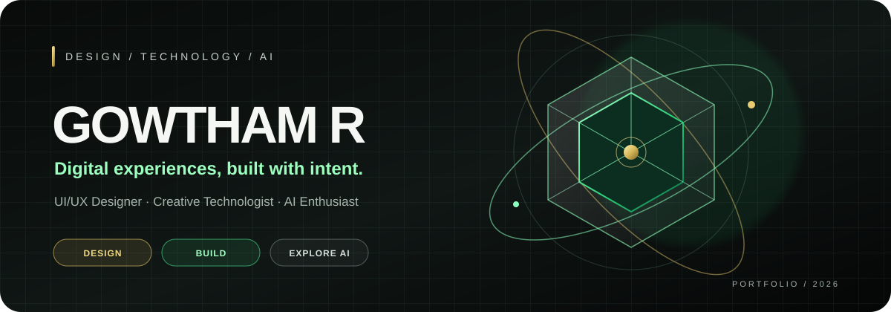
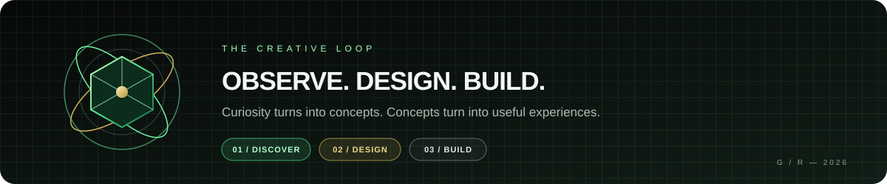

### I MAKE DIGITAL THINGS FEEL SIMPLE, DISTINCT, AND USEFUL.

---

## / 01 — THE PRACTICE

I’m a UI/UX designer and creative technologist exploring the space between **human-centered design, interactive web, and AI**. I like turning rough ideas into clear systems, expressive visuals, and useful digital products.

<table>
<tr>
<td width="33%" valign="top">

### ◇ THINK
**Understand the problem.**

User journeys, research, information architecture, and product strategy.

</td>
<td width="33%" valign="top">

### ✳ DESIGN
**Give the idea a form.**

Interfaces, prototypes, design systems, visual storytelling, and brand language.

</td>
<td width="33%" valign="top">

### ⌘ BUILD
**Make it real.**

Web experiments, AI concepts, working prototypes, and iterative improvement.

</td>
</tr>
</table>

## / 02 — SELECTED PROJECTS

<table>
<tr>
<td width="50%" valign="top">

### Gowtham_R
My personal portfolio and creative playground for design and development.

[OPEN PROJECT ↗](https://github.com/Gowthamrudhrappan/Gowtham_R)

</td>
<td width="50%" valign="top">

### Career Recommendation & Salary Predictor
Exploring career recommendations and salary insights with an AI-focused dashboard.

[OPEN PROJECT ↗](https://github.com/Gowthamrudhrappan/Personal-AI-Career-Recommendation-Salary-Predictor-Dashboard)

</td>
</tr>
<tr>
<td width="50%" valign="top">

### Heart Disease Risk Predictor
A machine-learning project focused on health-risk prediction.

[OPEN PROJECT ↗](https://github.com/Gowthamrudhrappan/Heart-Disease-Risk-Predictor)

</td>
<td width="50%" valign="top">

### PIVOTPATH
An AI-oriented career transition advisor concept.

[OPEN PROJECT ↗](https://github.com/Gowthamrudhrappan/PIVOTPATH-AI-CAREER-TRANSITION-ADVISOR)

</td>
</tr>
</table>

## / 03 — THE TOOLKIT

## / 04 — CURRENT CURIOSITIES

- How can interfaces communicate more with less?
- Where can AI genuinely improve a user's experience?
- How can motion and interaction make digital products feel more intuitive?

---

### GOOD DESIGN ISN'T DECORATION. IT'S HOW THE IDEA WORKS.

**Have an interesting problem? Let's make something meaningful.**

[GitHub](https://github.com/Gowthamrudhrappan) · [VIP25](https://vip25.online)

DESIGNED WITH CURIOSITY · BUILT THROUGH EXPERIMENTATION

